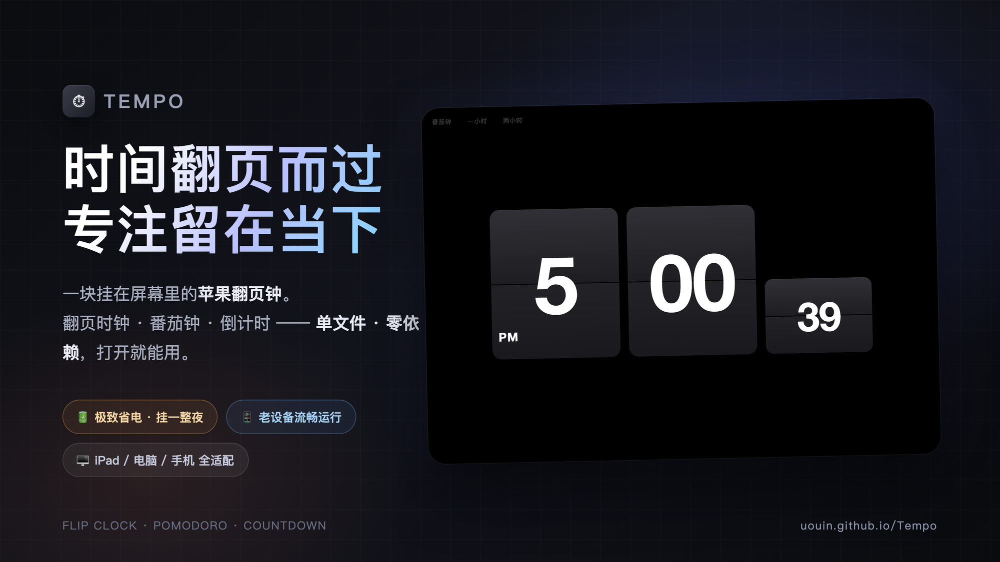
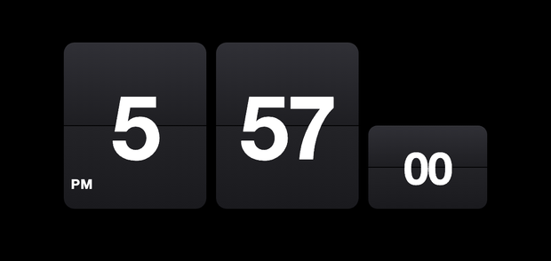
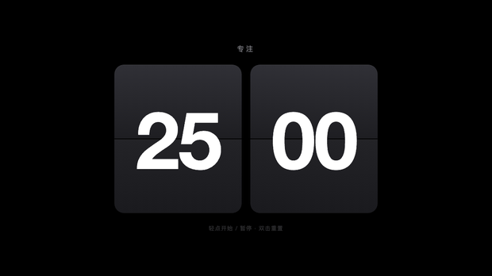

# ⏱ Tempo

**时间翻页而过，专注留在当下。**

翻页时钟 · 番茄钟 · 倒计时 —— 一块挂在屏幕里的苹果翻页钟。

---

## 👀 先看它动起来

**每一次数字变化，都是一次真实的翻页。**

---

## ✨ 三种模式，一键切换

左上角有三个**刻意做得很淡**的小按钮：`番茄钟 · 一小时 · 两小时`。
点哪个进哪个；正在用的那个会微微亮起、变成「时钟」—— 点它随时回家。

### 🕐 翻页时钟

时、分、秒各一张卡，秒卡乖巧地待在右下角。
数字变化的瞬间，上半片向你折下、下半片从折缝垂落 —— 和真实翻页钟一模一样的手感。

轻点左下角的 `AM / PM`，12 小时制和 24 小时制随心切换，你的选择它记得。

<table><tr>
<td></td>
<td></td>
</tr><tr>
<td align="center">12 小时制 · AM/PM 角标</td>
<td align="center">24 小时制 · 一点即换</td>
</tr></table>

### 🍅 番茄钟

专注的节奏，交给卡片来打拍子：

- **25 分钟专注 ⇄ 5 分钟休息**，一段结束自动翻入下一段，不用你操心
- **轻点卡片** = 开始 / 暂停，**双击卡片** = 重新开始
- 中途熄屏、切去干别的，回来进度分秒不差

### ⏳ 一小时 / 两小时倒计时

给「再干一小时的活」一个庄严的倒计时：
`时 : 分 : 秒` 三卡翻页倒数，数到 `00:00:00` 稳稳停住。交互和番茄钟一样：轻点暂停，双击重来。

---

## 🖥 大屏才是它的主场

为横屏而生 —— 卡片永远占据屏幕的主角，电脑、iPad、手机横过来都撑得满满当当。

<table><tr>
<td></td>
<td></td>
</tr><tr>
<td align="center">iPad 横屏 · 床头钟 / 桌面钟</td>
<td align="center">手机横屏 · 同样撑满</td>
</tr></table>

旋转屏幕即时重排，横竖都好看。

---

## 🔋 挂一整夜，也不心疼电

这块钟是按「7×24 挂在床头」的标准打磨的：

| | |
|---|---|
| 😴 **大部分时间在睡觉** | 每一秒只在数字翻动的一瞬间醒来干活，干完立刻接着睡 |
| 🌙 **熄屏就彻底休息** | 屏幕一关，它比你的 iPad 睡得还沉；点亮的一瞬间，时间已经悄悄对准 |
| ⏱ **永远准点** | 时间直接问系统要，不走秒、不漂移，挂一年也不会慢 |
| 📵 **不联网、不偷跑** | 断网照样跑，零流量、零后台、零小动作 |

实测挂着它一整晚，掉电肉眼可感地少 —— **床头钟、桌面钟、厨房计时器，随时挂、随便挂。**

---

## 🏺 为老设备而生

家里的旧 iPad 吃灰了？让它发挥余热。

Tempo 特意为**老系统做了深度兼容**：哪怕是一台几年没更新、还停在 iPadOS 14 的老 iPad，也能满速流畅运行，一样是丝滑的翻页动画、一样是极致的省电。

> 旧平板 + 一根充电线 + 一个支架 = 一块高级床头翻页钟。

---

## 🚀 开始使用

**在线版（推荐）：** 打开 [**uouin.github.io/Tempo**](https://uouin.github.io/Tempo/)，什么都不用装。

**iPad 全屏玩法：**

1. 用 Safari 打开页面
2. 分享 → **添加到主屏幕**
3. 从主屏幕图标打开 —— 没有地址栏、没有工具栏，就是一块纯粹的翻页钟

**本地运行：** 就一个 `index.html`，下载双击即可。

---

**Tempo** —— 时间翻页而过，专注留在当下。

[🌐 打开在线版](https://uouin.github.io/Tempo/) · [⭐ 给个 Star](https://github.com/uouin/Tempo)

<i>单文件 · 零依赖 · 不联网 · 老设备友好</i>

