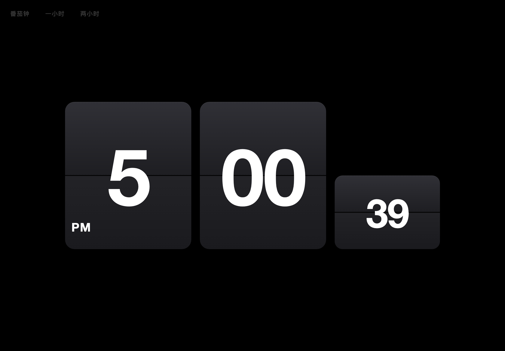
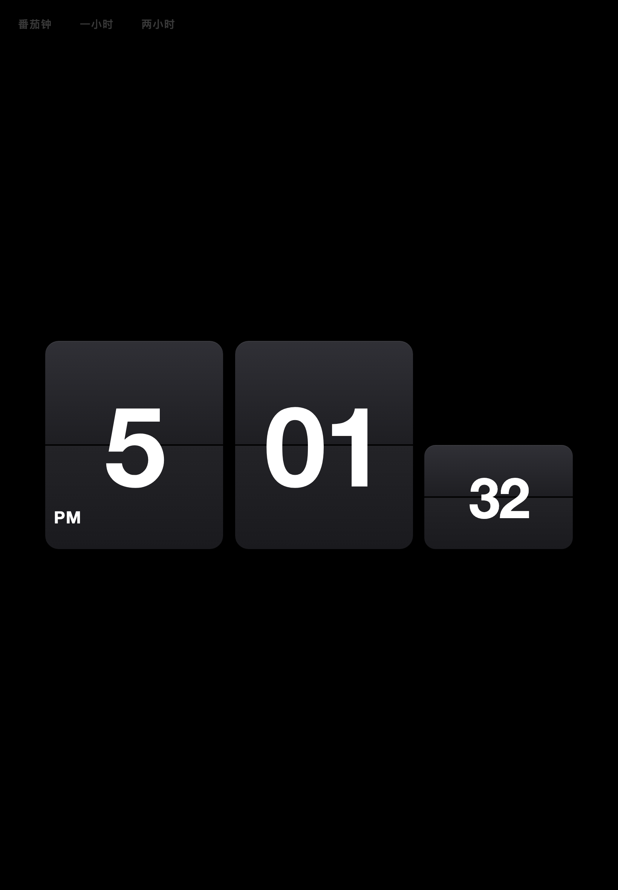
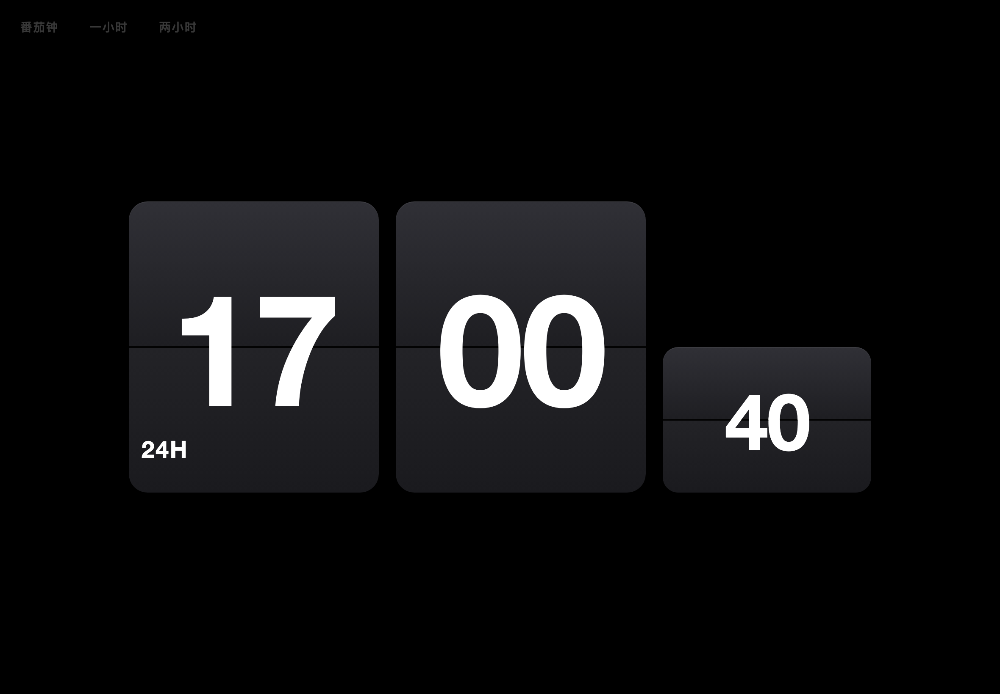
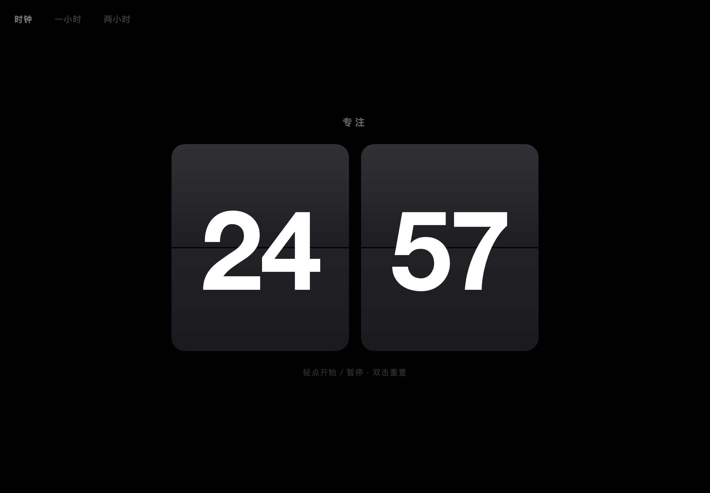
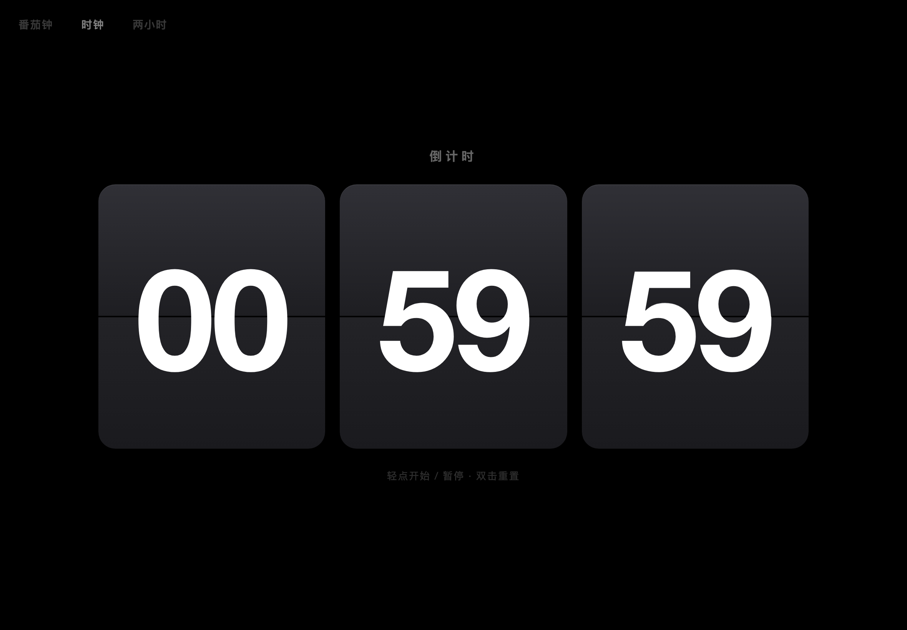
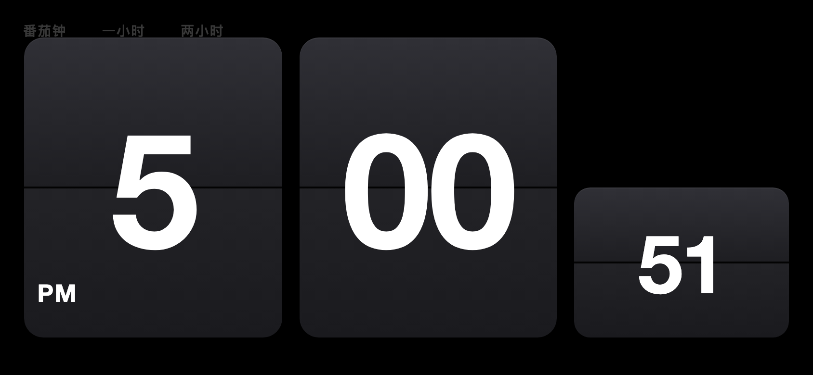

# ⏱ Tempo

**一块挂在墙上的苹果翻页钟，现在挂在你的屏幕里。**

深空色的卡片、翻落时那一声无声的「啪嗒」、
秒针走过时轻巧的一翻 —— 全部浓缩在一个 25 KB 的 HTML 文件里。

---

## 🖼 一眼看遍

**翻页时钟 · 时 / 分 / 秒三卡各司其职**

数字翻落的瞬间，是整块卡片的重量感 ——
上半片向你折下，下半片从折缝垂落，与真实翻页钟如出一辙。

---

## ✨ 功能

### 🕐 翻页时钟

- **时 / 分 / 秒各一张卡**，秒卡只有分钟卡的一半高，安静地待在右下角
- **12 / 24 小时制一键切换** —— 轻点小时卡左下角的 `AM / PM` 角标即可，选择会被记住
- 每一次数字变化都伴随完整的翻页动画，而非生硬的替换

| 12 小时制 | 24 小时制 |
|:---:|:---:|
|  |  |

### 🍅 番茄钟

专注与休息的节奏，交给卡片来打拍子：

- **25 分钟专注 ⇄ 5 分钟休息**，一段结束自动无缝翻入下一段
- 「专注 / 休息」状态字样悬在卡片上方，一眼可辨
- **轻点卡片** = 开始 / 暂停，**双击卡片** = 重置回满时长
- 基于绝对时间戳走时 —— 熄屏、切后台，回来进度分毫不差

### ⏳ 一小时 / 两小时倒计时

给「再干一小时的活」一个庄严的倒计时：

- 左上角淡淡的 `一小时` / `两小时` 按钮，点一下立刻开始倒数
- `HH : MM : SS` 三卡翻页，数到 `00:00:00` 稳稳停住
- 交互与番茄钟完全一致：轻点暂停，双击重来

### 🔀 三种模式，一键切换

左上角三个**刻意做得很淡**的按钮：`番茄钟 · 一小时 · 两小时`。

- 点非激活按钮进入对应模式；当前激活的按钮会亮一点、变成「时钟」，点它回家
- 三个视图**各自独立计时** —— 番茄钟走到一半切去倒计时，回来进度还在

---

## 📱 全设备适配

卡片永远占据屏幕的主角位置：电脑、iPad、手机，横竖屏都撑得恰到好处。

| iPad 竖屏 | 手机横屏 |
|:---:|:---:|
|  |  |

- 所有尺寸由 JS 按屏幕像素实时计算，旋转屏幕即时重排
- 兼容 iPadOS 14 Safari（无 flex gap、无新语法、全 -webkit 前缀）

---

## 🔋 为「常年挂在墙上」而生的省电设计

这块钟的目标是 7×24 挂在 iPad 上当床头钟 / 桌面钟，所以对功耗近乎偏执：

| 优化 | 说明 |
|---|---|
| ⏰ **秒边界对齐唤醒** | 不用固定 1 秒轮询，每次唤醒精确落在数字变化的一瞬 —— 一秒只醒一次，次次有用 |
| 🌙 **后台彻底休眠** | 熄屏 / 切后台时清除全部定时器，JS 零活动；回到前台自动重启，时间直接读系统时钟 |
| 🚫 **零冗余合成层** | 不残留任何 3D perspective，翻页动画只用轻量的 2D 变换 |
| 🔇 **隐藏视图零动画** | 切走的视图只更新数据，不做任何视觉渲染 |
| 📡 **零网络请求** | 时间恒读本地系统时钟，理论上零漂移，无需校准 |

**实测：** 秒翻页与真实秒边界误差 < 40ms，长时间挂机不漂移、不发热。

---

## 🚀 开始使用

**在线版（推荐）：** 直接打开 [**uouin.github.io/Tempo**](https://uouin.github.io/Tempo/)

**iPad 全屏玩法：**

1. 用 Safari 打开页面
2. 分享 → **添加到主屏幕**
3. 从主屏幕图标打开 —— 无地址栏、无工具栏，一块纯粹的翻页钟

**本地运行：** 就一个文件，下载 `index.html` 双击即可。

---

## 🛠 实现要点

- **单文件、零依赖**：全部 HTML / CSS / JS 手写在 `index.html` 里
- **翻页动画**：2D scaleY 压缩翻转（前片 1→0 收合，后片 0→1 展开），规避了 Safari 对 3D 变换 + overflow 裁剪的渲染怪癖，所有浏览器表现一致
- **几何定位**：CSS 只用百分比 + 溢出裁剪，尺寸全部由 JS 计算内联写入 —— 不依赖 calc / CSS 变量 / vmin，老 WebKit 也不出错
- **暂停竞态处理**：翻页动画进行中遇到暂停，立即结算到目标值，两个定时器永不打架

---

**Tempo** —— 时间翻页而过，专注留在当下。

[🌐 打开在线版](https://uouin.github.io/Tempo/) · [⭐ 给个 Star](https://github.com/uouin/Tempo)

